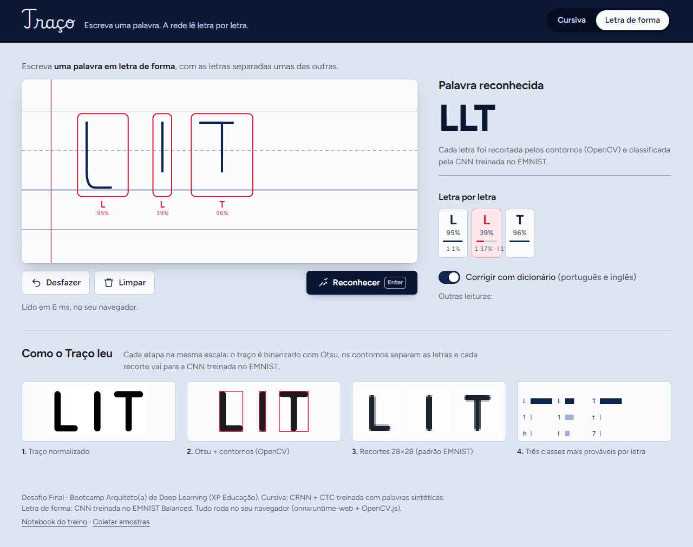

# Traço ✍️

> **Reconhecimento de escrita à mão (cursiva e letra de forma) direto no navegador — sem servidor, com `onnxruntime-web` e `OpenCV.js`.**

Prova de conceito desenvolvida para o **Desafio Final do Bootcamp Arquiteto(a) de Deep Learning (XP Educação)**. Você escreve uma palavra na folha pautada (com mouse, dedo ou caneta) e a aplicação segmenta as letras, classifica cada uma e exibe o passo a passo do pipeline em tempo real.



---

## ✨ Principais recursos

- **100% no navegador (Client-side):** inferência via WebAssembly (`onnxruntime-web`) e visão computacional com `OpenCV.js`, sem backend nem envio de dados para servidor.
- **Dois modos de escrita:**
  - **Cursiva (padrão):** rede **CRNN (CNN + BiLSTM)** com perda **CTC**, treinada em palavras sintéticas (fontes cursivas esqueletizadas, traço uniforme e distorções). A própria CTC alinha e separa as letras na imagem, com opção de correção via **Beam Search restrito a léxico** (português e inglês).
  - **Letra de forma:** **CNN** treinada no **EMNIST Balanced** (47 classes, ~88,3% de acurácia em teste). As letras são separadas por contornos externos no OpenCV (`GaussianBlur` → `Otsu` → `findContours` → `boundingRect`) e normalizadas em recortes `28×28`.
- **Pipeline transparente e inspecionável:** exibe lado a lado as 4 etapas da leitura:
  1. Traço normalizado
  2. Binarização com Otsu + caixas de contorno (OpenCV)
  3. Tensor de entrada da rede (`32×256` na cursiva ou recortes `28×28` na letra de forma)
  4. Probabilidades por quadro (CTC) ou top-3 classes por letra
- **Pronto para uso em desktop e mobile:** suporte a mouse, toque e caneta (`PointerEvents`), atalhos de teclado (`Enter` para reconhecer, `Ctrl+Z` para desfazer, `Esc` para limpar) e modo opcional de coleta de amostras (`?coletar=1`).

---

## 🏗️ Arquitetura do Pipeline

```text
Traços vetoriais (Canvas)
  │
  ▼
Re-renderização normalizada (escala e espessura)
  │
  ▼
OpenCV.js: Cinza → GaussianBlur(5×5) → Threshold(BINARY_INV + OTSU) → findContours
  │
  ├──► Modo Cursiva ────────► Tensor 1×1×32×256 ─► CRNN (ONNX) ─► 64×27 probs ─► CTC Greedy / Lexicon Beam
  │
  └──► Modo Letra de forma ─► Recortes N×1×28×28 ─► CNN EMNIST (ONNX) ─► Top-3 classes por letra
```

---

## 📁 Estrutura do Repositório

```text
.
├── space/                  # Aplicação web estática (pronta para Hugging Face Spaces)
│   ├── index.html          # Página principal
│   ├── css/styles.css      # Estilos (tema caderno de caligrafia)
│   ├── js/                 # Módulos ES (canvas, OpenCV, ONNX, CTC, léxico)
│   ├── models/             # Modelos exportados (cursive_crnn.onnx e emnist_cnn.onnx)
│   ├── data/lexicon.txt    # Léxico PT/EN para Beam Search
│   └── notebook/           # Cópia do notebook de treino e avaliação
├── training/               # Scripts PyTorch de geração de dados, treino, avaliação e exportação ONNX
├── notebooks/              # Notebook principal (desafio_final.ipynb)
├── tests/                  # Testes de paridade JS × Python (tests/parity.test.mjs)
├── artifacts/              # Gráficos, matriz de confusão e métricas de treino
└── docs/                   # Imagens de documentação
```

---

## 🚀 Como rodar localmente

Como a aplicação usa módulos ES e `fetch()` para carregar os modelos `.onnx` e o léxico, ela precisa ser servida via HTTP (não funciona abrindo o `index.html` diretamente via `file://`):

```bash
cd space
python -m http.server 8000
```

Acesse **`http://localhost:8000`** no navegador.

### Rodar os testes de paridade (JS × Python)

```bash
node tests/parity.test.mjs
```

---

## ☁️ Deploy no Hugging Face Spaces

A pasta `space/` já está configurada como um Space estático (`sdk: static` em `space/README.md`). Para publicar:

```bash
pip install huggingface_hub
python training/deploy_hf.py --repo SEU_USUARIO/traco --token SEU_TOKEN_HF
```

---

## 🛠️ Tecnologias Utilizadas

- **Deep Learning & Exportação:** PyTorch, ONNX, `onnxruntime-web` (WASM)
- **Visão Computacional:** OpenCV.js (`4.10.0`)
- **Frontend:** HTML5, CSS3, JavaScript (ES Modules, Canvas 2D, SVG)
